# FlowPulse — Document de conception

Équipe Mboa Labs · AI for Good Lab Hackathon : United Arab Emirates (ITU) · version du 22 octobre 2026

## Vue d'ensemble

FlowPulse est une plateforme d'aide à la décision pour la mobilité urbaine de Yaoundé. Ses agents IA anticipent la congestion à partir des données d'antennes mobiles et recommandent des réaffectations de bus. Chaque recommandation est justifiée par les textes réglementaires camerounais.

- **Problème** : congestion imprévisible et offre de bus planifiée sur des données démographiques obsolètes.
- **Solution** : carte de chaleur des flux, prédiction des axes saturés, agents qui détectent, optimisent, simulent et vérifient la conformité, et un superviseur conversationnel.
- **Contexte de démo** : Yaoundé (Communauté Urbaine, opérateur de bus, opérateurs télécoms), base de connaissances sur le droit camerounais.
- **Choix techniques retenus** : React, Spring Boot, service IA en Python (FastAPI), LLM open source local via Ollama, PostgreSQL.
- **Échéance** : rendu le 10 novembre 2026, finale à Dubaï le 8 décembre 2026 pendant GITEX.

## Alignement avec les critères ITU

Le jury ne note pas la précision du prototype ; il note la base de connaissances, le respect des lois par l'agent, les manques réglementaires, l'auditabilité et l'alignement ITU. Chaque critère a donc une brique dédiée dans FlowPulse.

| Critère ITU | Ce que le jury regarde | Réponse FlowPulse |
| --- | --- | --- |
| Qualité de la base de connaissances | Complétude, exactitude, structure des textes nationaux, récupération du contexte | KB des textes camerounais découpés par article, métadonnées (loi, article, date, autorité), recherche par RAG |
| Capacité de l'agent | Pertinence des réponses dans des scénarios d'incident, respect des lois et circuits de coordination | Agent Politique qui valide chaque recommandation ; scénarios d'incident scripts (marché Mokolo, rentrée scolaire, route fermée) |
| Identification des manques | Responsabilités floues, normes absentes, vides juridiques, coordination, objectifs contradictoires | Registre des manques alimenté par l'agent quand aucun texte ne couvre une décision, comparé à des exemples d'autres pays |
| Auditabilité | Journaux, traces de raisonnement, sources citées | Table `agent_traces` : chaque étape, outil appelé, source citée ; visible dans l'interface |
| Alignement ITU | Pipeline Y.3172 et AI Readiness Framework | Architecture découpée selon les nœuds Y.3172 (section dédiée) |

**Livrables au 10 novembre** : rapport technique de 5 pages (modèle officiel), dépôt GitHub, base de connaissances, vidéo de démo de 7 minutes maximum (obligatoire si présélectionnés). Source : [page officielle du hackathon](https://aiforgood.itu.int/event/ai-for-good-sandbox-hackathon-united-arab-emirates/).

## Acteurs et cas d'utilisation

Quatre acteurs humains et deux acteurs système (les agents IA et le LLM). L'acteur « Usager » et l'itinéraire optimal sortent du périmètre du hackathon ; les références à Dakar et à l'avenue Bourguiba sont remplacées par des lieux de Yaoundé.

| Cas d'utilisation | Acteur | Périmètre |
| --- | --- | --- |
| F0.1 S'authentifier, redirection par rôle | Tous | MVP |
| F0.2 Session, déconnexion auto, journaux d'audit | Tous | MVP |
| F1.1 Tableau de bord : carte de chaleur, KPIs | Gestionnaire urbain | MVP |
| F1.2 Alertes prédictives : acquitter, transmettre, contingence | Gestionnaire urbain | MVP |
| F1.3 Superviseur conversationnel avec sources et trace | Gestionnaire urbain, Opérateur | MVP |
| F2.1 Adéquation offre / demande par arrêt | Opérateur de transport | MVP |
| F2.2 Valider ou rejeter une recommandation de flotte | Opérateur de transport | MVP |
| F2.3 Historique des interventions | Opérateur de transport | Si le temps le permet |
| F3.1 Simulation What-If | Urbaniste | Si le temps le permet (version simple visée) |
| F3.2 Indicateurs de mobilité, export CSV | Urbaniste | Si le temps le permet |
| F3.3 Registre des manques réglementaires (nouveau) | Urbaniste, Gestionnaire | MVP |
| F4.1 Gestion des utilisateurs et rôles | Administrateur | MVP (création de comptes par l'admin, pas d'inscription libre) |
| F4.2 Supervision des pipelines et agents | Administrateur | Si le temps le permet |
| F4.3 Gestion de la base de connaissances (nouveau) | Administrateur | MVP |
| Commandes vocales, itinéraire usager | — | Hors périmètre |

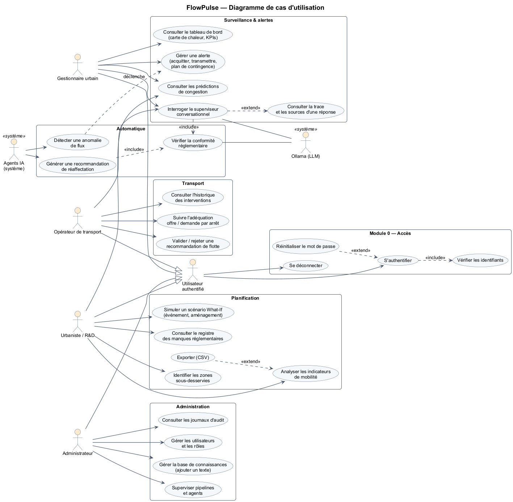

Source : `conception/diagrammes/02_cas_utilisation.puml`.

## Architecture technique

L'architecture v1 (React, Spring Boot, PostgreSQL) est conservée ; la v2 ajoute un service IA Python, un serveur Ollama local et trois schémas de base de données. Spring Boot reste la seule porte d'entrée du frontend : il porte la sécurité, le métier et l'audit.

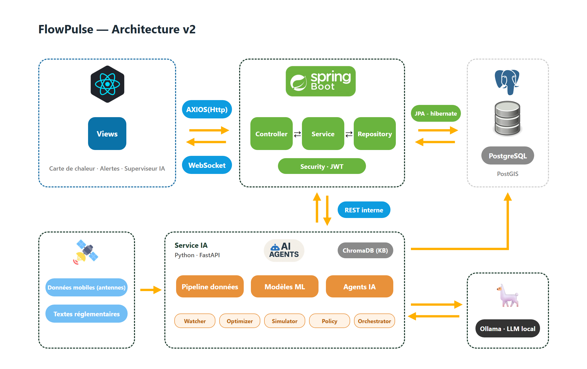

Même structure que la v1 (React, Spring Boot, PostgreSQL) ; la v2 ajoute en bas le service IA, la source de données et Ollama en local.

| Composant | Technologie | Responsabilité |
| --- | --- | --- |
| Frontend | React + Vite, MapLibre + deck.gl, Axios, STOMP | Carte de chaleur, alertes temps réel, flotte, simulation, chat, admin |
| Backend métier | Spring Boot 3, Java 21, Spring Security (JWT), JPA/Hibernate, WebSocket | Auth et rôles, API REST, alertes, flotte, scénarios, audit, notifications |
| Service IA | Python 3.11, FastAPI, LangGraph, scikit-learn / LightGBM, OR-Tools, NetworkX, bandicoot | Pipeline de données, modèles, agents, ingestion de la KB, traces |
| LLM local | Ollama : `qwen2.5:14b` (raisonnement), `nomic-embed-text` (vecteurs), comme le code de référence ITU | Raisonnement, appels d'outils, rédaction, vecteurs de la KB |
| Base relationnelle | PostgreSQL 16 + PostGIS | Schémas `app` (Spring) et `mobility` (service IA), traces d'agents |
| Base de connaissances | ChromaDB (persistant, dans le service IA) | Collections de textes réglementaires, cadre ITU, manques ; même moteur que le dépôt ITUAIReadiness |
| Déploiement | docker-compose (6 conteneurs) | Même stack en local, en démo et à la finale |

**Flux clés.** Le frontend appelle uniquement Spring Boot (HTTPS + WebSocket). Spring appelle le service IA en REST interne ; le Watcher remonte les alertes à Spring par webhook. Le LLM tourne en local : aucune donnée de mobilité ne quitte le serveur, un argument de souveraineté à mettre en avant.

**Déploiement (docker-compose)**

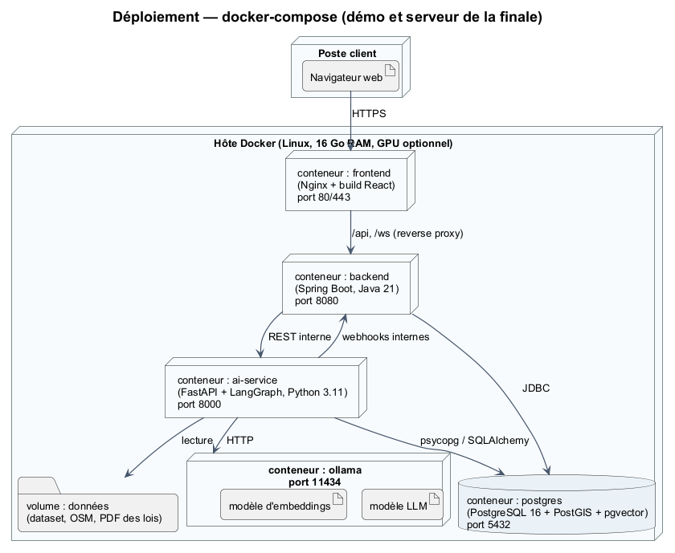

Sources : `conception/architecture/architecture_v2.html`, `10_deploiement.puml`.

## Correspondance Y.3172 et AI Readiness Framework

Chaque nœud de la recommandation ITU-T Y.3172 a un composant FlowPulse identifiable ; le Simulateur What-If joue le rôle du bac à sable (sandbox) prévu par la norme.

| Nœud Y.3172 | Composant FlowPulse | Preuve dans le dépôt |
| --- | --- | --- |
| SRC (source) | Dataset opérateur télécom, OSM Yaoundé, réseau de bus, textes réglementaires | `ai-service/adapters/` |
| C (collecteur) | Ingestion et contrôle du contrat de données | `ai-service/pipeline/ingest.py` |
| PP (prétraitement) | Anonymisation (seuil k ≥ 10), rattachement aux zones, indicateurs bandicoot, matrices O-D | `ai-service/pipeline/` |
| M (modèle) | Prédiction de saturation, clustering DBSCAN | `ai-service/ml/` |
| P (politique) | Agent Politique et Conformité | `ai-service/agents/policy.py` |
| D (distribution) | Orchestrator, webhooks vers Spring, WebSocket | `ai-service/agents/orchestrator.py`, `backend/notifications` |
| SINK (destination) | Dashboard gestionnaire, écran opérateur | `frontend/` |
| MLFO (orchestration) | Planificateur des agents et versions de modèles | `ai-service/scheduler.py` |
| Sandbox | Simulator Agent (What-If) | `ai-service/agents/simulator.py` |

**AI Readiness Framework 2.0.** Le cadre compte 6 facteurs (Data, Research, Deployment, Standards, Open source, Sandbox) et 13 dimensions. Le code de référence ITU relie chaque nœud Y.3172 à des dimensions ; FlowPulse reprend cette correspondance dans son rapport.

| Nœud Y.3172 | Facteur ITU | Dimensions concernées | Apport de FlowPulse |
| --- | --- | --- | --- |
| SRC, C, PP | Data | 1 Marché de données, 2 Contenu généré, 3 Corrélation inter-domaines, 4 Contextualisation, 13 Infrastructure numérique | Données télécom agrégées croisées avec le réseau de bus et OSM |
| M | Research | 2 Contenu généré, 5 Intégration de l'IA, 9 Impact humain | Prédiction de saturation et clustering adaptés à Yaoundé |
| P | Standards | 7 Alignement stratégique, 8 Collaboration avec l'IA, 10 IA et politiques | Agent Politique ancré dans les textes camerounais, registre des manques |
| D, SINK | Deployment | 5 Intégration, 6 Interface humaine, 12 Priorités granulaires, 13 Infrastructure | Recommandations par arrêt et par ligne, validation humaine |
| MLFO | Standards | 5, 7, 8 | Orchestrator et planificateur des agents |
| Sandbox | Sandbox | 10 IA et politiques, 11 IA pour l'inclusion | Simulation What-If avant toute décision |

Source de la correspondance : `simulation/server/agents/usecase.py` du [dépôt ITUAIReadiness](https://github.com/CrashingGuru/ITUAIReadiness).

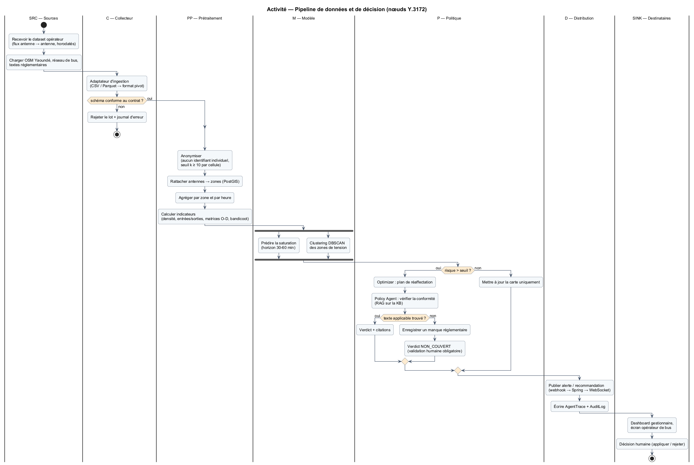

Source : `08_activite_pipeline_y3172.puml`.

## Système multi-agents

Cinq agents coordonnés par LangGraph ; aucune action n'est appliquée sans validation humaine, et toute recommandation passe par l'agent Politique avant d'être affichée.

| Agent | Déclencheur | Outils | Sortie |
| --- | --- | --- | --- |
| Watcher | Planifié toutes les X minutes | `predict()`, `cluster()` | Alerte (webhook vers Spring) |
| Optimizer | Alerte de zone en tension | `fleet_available()`, solveur OR-Tools | Plan de réaffectation des bus |
| Simulator | Scénario lancé par l'urbaniste | Graphe routier NetworkX (OSM), flux O-D | Rapport d'impact avant / après |
| Policy et Conformité | Tout plan ou réponse qui recommande une action | `search_kb()`, `check_compliance()`, `log_gap()` | Verdict (conforme, sous réserve, non conforme, non couvert) + citations |
| Orchestrator | Question en langage naturel | Tous les agents ci-dessus, requêtes de données | Réponse, citations, surbrillance carte, `traceId` |

**Garde-fous.**

- Validation humaine obligatoire avant toute application (bouton « Appliquer »).
- Une réponse sans source est marquée « non sourcée » dans l'interface.
- Aucune donnée individuelle dans les prompts : uniquement des agrégats par zone.
- Aucun texte applicable : verdict « non couvert » et création d'un manque réglementaire.
- Chaque étape (agent, outil, entrées, sorties, durée, sources) est écrite dans `agent_traces`.

**Rôles et outils des agents**

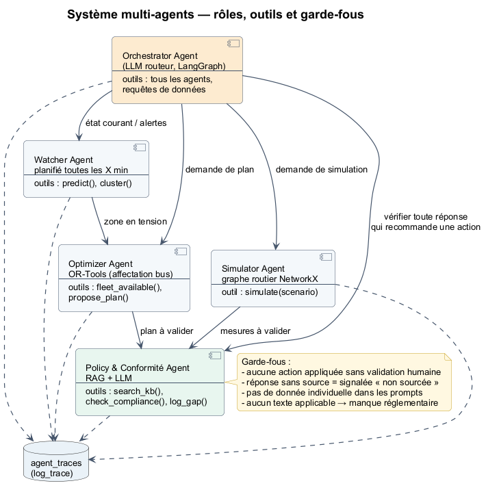

**Séquence : détection, recommandation conforme, validation humaine**

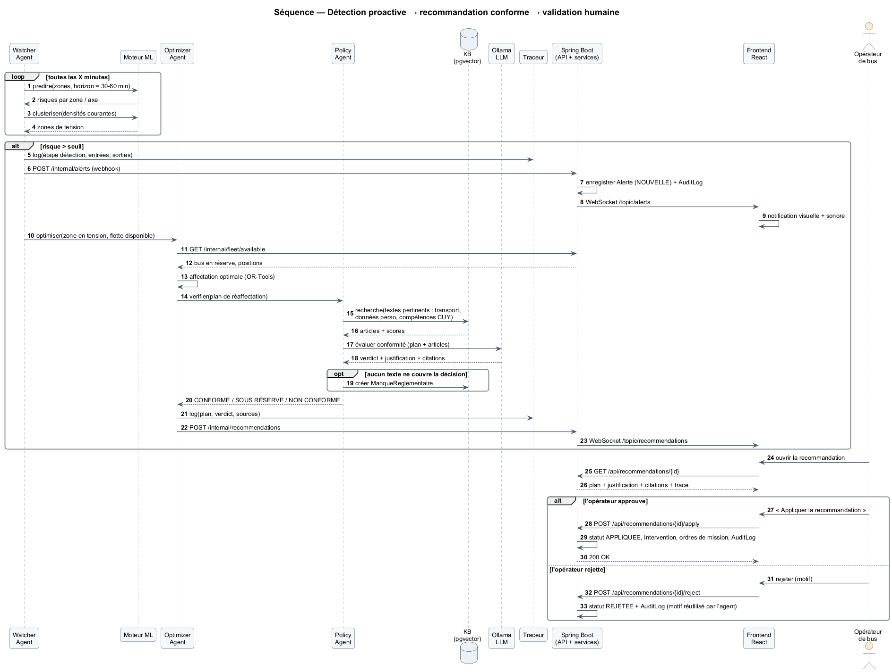

**Séquence : question au superviseur conversationnel**

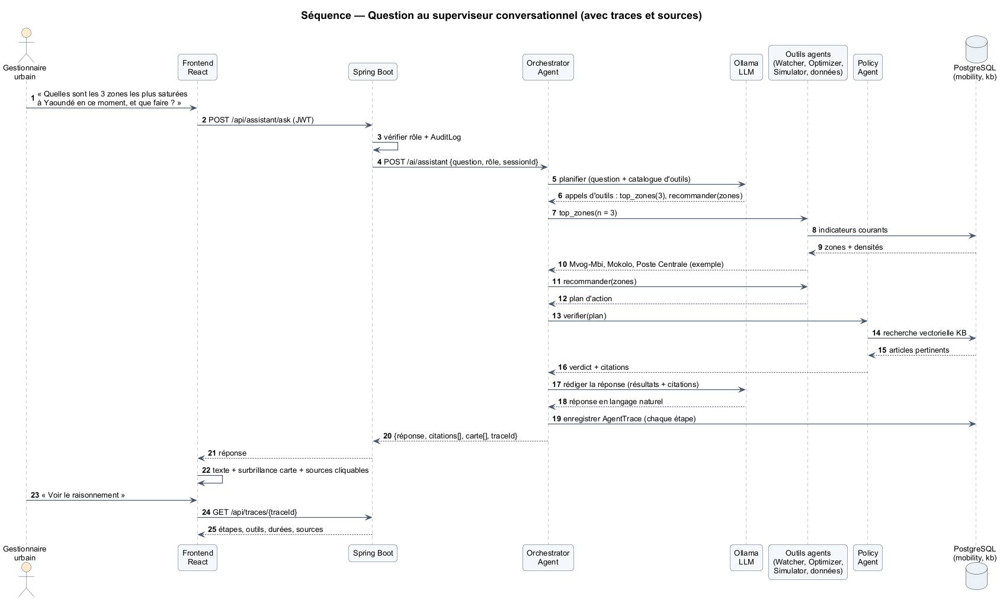

**Séquence : simulation What-If**

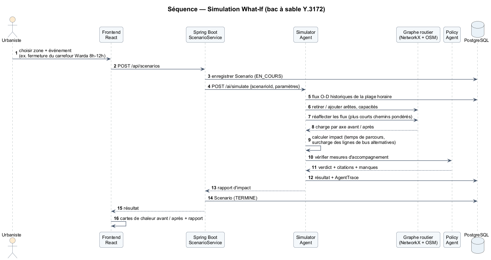

**Cycle de vie d'une alerte et d'une recommandation**

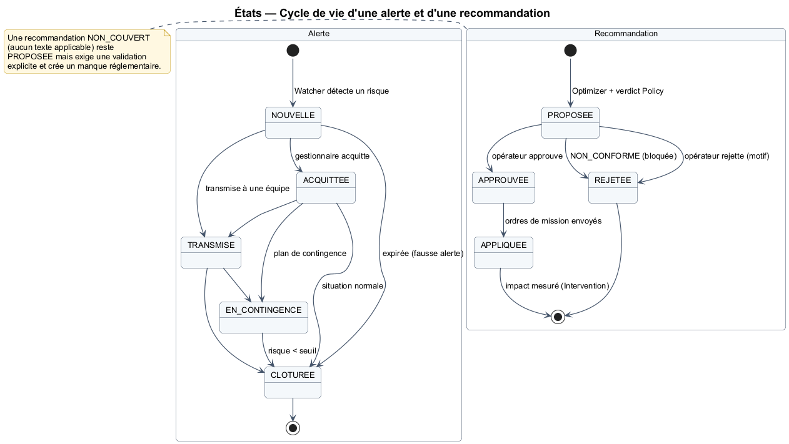

Sources : `11_agents.puml`, `04_sequence_alerte_recommandation.puml`, `05_sequence_superviseur.puml`, `07_sequence_simulation.puml`, `09_etats_alerte_recommandation.puml`.

## Base de connaissances réglementaire (Cameroun)

La KB découpe chaque texte en passages indexés avec leurs métadonnées (référence, article, autorité, date), pour que l'agent cite le passage exact. Elle reprend le pipeline du dépôt ITUAIReadiness : extraction PDF (PyMuPDF), découpage en passages de 256 mots avec 30 mots de recouvrement, vecteurs `nomic-embed-text` via Ollama, stockage ChromaDB. La structure détaillée est dans le dépôt `flowpulse-knowledge-base` (fichier README.md).

**Textes à collecter.** Références établies de mémoire : chaque intitulé et chaque date sont à vérifier sur le texte officiel avant indexation.

| Domaine | Texte visé | Pourquoi l'agent en a besoin |
| --- | --- | --- |
| Données personnelles | Loi relative à la protection des données à caractère personnel (adoptée fin 2024) | Usage des données d'antennes, anonymisation, finalité |
| Communications électroniques | Loi de 2010 régissant les communications électroniques ; textes de l'ART | Accès aux données des opérateurs, rôle du régulateur |
| Cybersécurité | Loi de 2010 sur la cybersécurité et la cybercriminalité ; rôle de l'ANTIC | Sécurité et conservation des données |
| Décentralisation | Code général des collectivités territoriales décentralisées (2019) | Compétences de la Communauté Urbaine de Yaoundé en transport urbain |
| Transport urbain | Textes sur le transport urbain par bus et la concession de l'exploitant ; Plan de Déplacements Urbains de Yaoundé | Qui peut modifier une ligne ou déplacer des bus |
| Stratégie nationale | SND30 ; stratégie numérique ; stratégie IA si publiée | Lien entre politique nationale et cas d'usage |
| Normes ITU | Y.3172, AI Readiness Framework 2.0 | Alignement exigé par le jury |
| Exemples internationaux | Règlementations comparables (UE, Émirats, Rwanda, etc.) | Comparer quand un manque est détecté |

**Registre des manques.** L'agent Politique crée une entrée quand une décision n'est couverte par aucun texte ou quand deux textes se contredisent. Chaque entrée porte une catégorie du jury : responsabilité floue, norme absente, vide juridique, problème de coordination, objectifs contradictoires. Exemples à instruire : qui autorise le partage de données agrégées entre opérateur télécom et commune ? Qui arbitre entre la Communauté Urbaine et l'exploitant de bus pour une réaffectation en temps réel ?

## Modèle de données et contrat du dataset

Le modèle compte 21 classes et 9 énumérations réparties en cinq paquets : accès et audit, territoire et mobilité, transport, décision et IA, base de connaissances. Le détail est dans `03_classes.puml`.

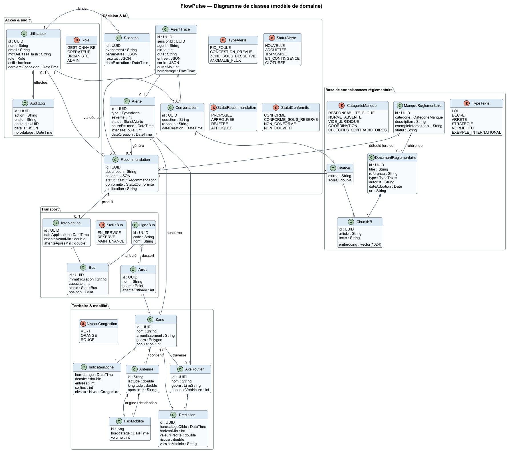

**Contrat du dataset (format pivot).** Tant que le dataset réel n'est pas fourni, un générateur produit des données synthétiques sur Yaoundé dans ce format. À l'arrivée du vrai dataset, seul un adaptateur est à écrire.

| Fichier | Colonnes | Grain |
| --- | --- | --- |
| `antennas.csv` | `antenna_id, lat, lon, operator` | Une ligne par antenne |
| `flows.csv` | `ts_hour, origin_antenna_id, dest_antenna_id, volume` | Une ligne par paire d'antennes et par heure, volume ≥ 10 |
| `presence.csv` | `ts_hour, antenna_id, unique_devices` | Densité par antenne et par heure |
| `bus_lines.csv` | `line_id, code, name, stop_ids` | Une ligne par ligne de bus |
| `bus_stops.csv` | `stop_id, name, lat, lon` | Une ligne par arrêt |
| `fleet.csv` | `bus_id, plate, capacity, status, line_id` | Une ligne par bus |
| `zones.geojson` | `zone_id, name, arrondissement, geometry` | Quartiers ou arrondissements de Yaoundé |

Exemple de lignes de `flows.csv` (données fictives) :

```csv
ts_hour,origin_antenna_id,dest_antenna_id,volume
2026-10-20T07:00,YDE-0142,YDE-0087,412
2026-10-20T07:00,YDE-0142,YDE-0031,156
2026-10-20T08:00,YDE-0087,YDE-0142,98
```

**Questions pour le responsable du dataset** : granularité temporelle réelle (heure, 15 min) ; présence de données individuelles (CDR) ou seulement d'agrégats ; période couverte ; données de bus disponibles ou à simuler.

## API entre composants

Le frontend ne parle qu'à Spring Boot (`/api/*`, protégé par JWT) ; le service IA expose `/ai/*` sur le réseau interne uniquement, et rappelle Spring par `/internal/*`.

| Méthode et route | Appelant → appelé | Rôle |
| --- | --- | --- |
| `POST /api/auth/login`, `/api/auth/refresh` | Frontend → Spring | Connexion, rafraîchissement du jeton |
| `GET /api/dashboard/heatmap?ts=` | Frontend → Spring → IA | Densités par zone et par heure |
| `GET /api/predictions?horizon=` | Frontend → Spring → IA | Risques de saturation par axe |
| `GET /api/alerts`, `PATCH /api/alerts/{id}` | Frontend → Spring | Lister, acquitter, transmettre, contingence |
| `GET /api/recommendations/{id}` | Frontend → Spring | Plan, justification, citations, trace |
| `POST /api/recommendations/{id}/apply` ou `/reject` | Frontend → Spring | Décision humaine |
| `POST /api/assistant/ask` | Frontend → Spring → IA | Question au superviseur |
| `GET /api/traces/{traceId}` | Frontend → Spring | Étapes de raisonnement et sources |
| `POST /api/scenarios` | Frontend → Spring → IA | Lancer une simulation |
| `GET /api/gaps` | Frontend → Spring | Registre des manques réglementaires |
| `POST /api/admin/kb/documents` | Frontend → Spring → IA | Ajouter un texte à la KB |
| `POST /internal/alerts`, `/internal/recommendations` | IA → Spring | Webhooks des agents |
| `GET /internal/fleet/available` | IA → Spring | Bus en réserve pour l'Optimizer |
| `WS /topic/alerts`, `/topic/recommendations` | Spring → Frontend | Notifications temps réel |

Le contrat détaillé sera publié en OpenAPI (Springdoc côté Spring, généré automatiquement par FastAPI côté IA).

## Sécurité, confidentialité, auditabilité

Aucune donnée individuelle n'est stockée ni envoyée au LLM, et chaque décision est rejouable à partir de ses traces.

- **Confidentialité** : agrégation par zone et par heure dès l'ingestion ; suppression des cellules de moins de 10 appareils ; LLM local (Ollama), aucune donnée envoyée à un service externe.
- **Authentification** : JWT (accès 15 min, rafraîchissement 7 jours), mots de passe hachés BCrypt, déconnexion après 30 min d'inactivité.
- **Contrôle d'accès** : rôles Gestionnaire, Opérateur, Urbaniste, Admin ; `@PreAuthorize` sur chaque route.
- **Isolation** : le service IA et Ollama ne sont joignables que depuis le réseau Docker interne.
- **Audit humain** : `audit_log` pour les actions critiques (connexion, acquittement, application ou rejet d'une recommandation, ajout d'un texte à la KB).
- **Audit des agents** : `agent_traces` pour chaque étape (agent, outil, entrées, sorties, durée, sources citées), consultable depuis l'interface par le bouton « Voir le raisonnement ».

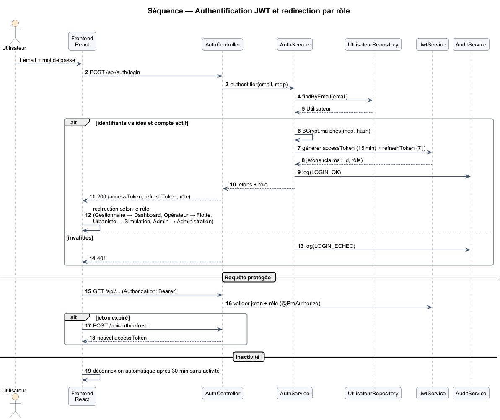

Source : `06_sequence_authentification.puml`.

## Planning et répartition

Le prototype doit être complet le 8 novembre pour laisser deux jours au rapport et à la vidéo ; la présélection est annoncée le 18 novembre et la finale a lieu à Dubaï le 8 décembre.

| Lot | Début | Fin |
| --- | --- | --- |
| Socle : dépôts, Docker, authentification | 21 oct. | 26 oct. |
| Base de connaissances | 22 oct. | 1er nov. |
| Pipeline + données fictives | 23 oct. | 30 oct. |
| Frontend React | 24 oct. | 6 nov. |
| Modèles ML | 27 oct. | 2 nov. |
| Agents IA | 28 oct. | 6 nov. |
| Rapport, vidéo, GitHub | 3 nov. | 9 nov. |
| Intégration et scénarios | 4 nov. | 8 nov. |
| **Rendu ITU** | **10 nov.** | |

Les lots se chevauchent pour que les quatre membres travaillent en parallèle dès la première semaine.

| Lot | Périmètre | Livrable |
| --- | --- | --- |
| Socle | Un dépôt par composant, docker-compose, Spring Security JWT, schémas de base | Stack qui démarre en une commande |
| Pipeline + données | Générateur synthétique Yaoundé, ingestion, anonymisation, indicateurs | Tables `mobility` remplies |
| Base de connaissances | Collecte des textes, découpage par article, indexation ChromaDB | KB interrogeable avec citations |
| Modèles ML | Prédiction de saturation, DBSCAN | Endpoints `predict` et `cluster` |
| Agents IA | Watcher, Optimizer, Policy, Orchestrator, traces | Alertes et recommandations conformes |
| Frontend | Carte de chaleur, alertes, flotte, chat, panneau de traces | Interface par rôle |
| Intégration | 3 scénarios d'incident scripts de bout en bout | Démo reproductible |
| Rapport | Rapport de 5 pages, vidéo de 7 min, README GitHub | Dossier de rendu |

## Questions ouvertes

- [ ] Composition de l'équipe : le règlement limite à 4 personnes (4 participants, ou 3 + 1 mentor interne). L'équipe déclare 4 membres + 1 mentor : à confirmer auprès des organisateurs.
- [ ] Désigner une cheffe d'équipe pour l'éligibilité au prix Women's Team (600 CHF).
- [ ] Dataset : granularité, agrégats ou données individuelles, période, présence de données de bus.
- [ ] Modèle Ollama retenu selon la machine de démo (RAM, GPU) : test de qualité en français et d'appels d'outils.
- [ ] Collecte et vérification des textes camerounais de la KB (intitulés, dates, versions officielles).
- [ ] Télécharger le modèle officiel du rapport (.docx) ; cloner le dépôt ITUAIReadiness et faire tourner son agent Use Case sur FlowPulse.
- [ ] Répartition des lots entre les membres de l'équipe.

## Sources

- [AI for Good Lab Hackathon: United Arab Emirates — ITU](https://aiforgood.itu.int/event/ai-for-good-sandbox-hackathon-united-arab-emirates/)
- Documents de l'équipe : fiche projet, description des cas d'utilisation, architecture v1, diagramme de cas d'utilisation v1.
